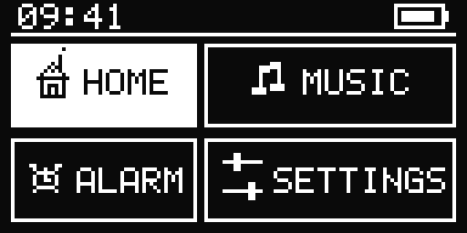
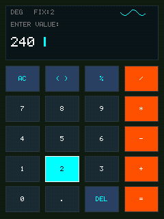

# ✦ Glyph

Glyph is a lightweight, zero-heap 2D graphics framework for bare-metal embedded systems, written in **Ada 2022**.

Built on standard **Ada HAL (`HAL.I2C`, `HAL.SPI`)**, Glyph provides embedded-first display drivers for **SSD1306** monochrome OLEDs and **ILI9341** 16-bit color TFTs on the **RP2040** (Raspberry Pi Pico), with zero dynamic heap allocation.

  
  &nbsp;&nbsp;&nbsp;&nbsp;&nbsp;&nbsp;&nbsp;&nbsp;
  

  <b>SSD1306 (128×64 Monochrome OLED · I2C)</b> &nbsp;&nbsp;&bull;&nbsp;&nbsp; <b>ILI9341 (240×320 16-Bit Color TFT · SPI)</b> 
  <i>Retro cassette player ("Sailor Song") &nbsp;&bull;&nbsp; Mechanical scientific calculator with live sine wave preview</i> 
  Zero dynamic allocation &bull; Real-time hardware rendering &bull; RP2040 bare-metal drivers

---

## Documentation

Full interactive documentation, beginner tutorials, and architecture guides are available online at **[thirstymelon.github.io/glyph](https://thirstymelon.github.io/glyph/)**:

- **[Getting Started](https://thirstymelon.github.io/glyph/getting-started.html)**: Toolchain installation, project setup, and flashing RP2040 firmware.
- **[Beginner Tutorials](https://thirstymelon.github.io/glyph/tutorials/index.html)**: 9-lesson hands-on curriculum using SSD1306 and ILI9341 on the RP2040.
- **[Developer Overview](https://thirstymelon.github.io/glyph/developer-overview.html)**: Systems architecture, rendering pipelines, memory model, tile streaming, and simulator internals.
- **[API Reference](https://thirstymelon.github.io/glyph/reference.html)**: Signatures and routines for display drivers, primitives, and color manipulation.
---

## Features

- **Ada 2022**: Modern type safety, strict contracts, and deterministic execution.
- **Zero Dynamic Allocation**: Fixed compile-time buffers with zero heap allocation.
- **Embedded-First Drivers**: Direct drivers for SSD1306 (I2C OLED) and ILI9341 (SPI TFT).
- **2D Drawing Primitives**: Pixels, lines (Bresenham with fast orthogonal bypass), rectangles, circles, arcs, sectors, triangles, and bitmap text.
- **Transparent Tile Streaming**: Render 240x320 color TFTs using just 15 KB RAM instead of 153.6 KB.
- **Hidden Damage Tracking**: Minimizes bus traffic by calculating dirty bounding boxes and flushing only changed regions.
- **Desktop Simulator**: Standalone simulator for macOS, Linux, and Windows with multi-format media export (BMP, GIF, MP4).

---

## About the Project

Glyph is both an open-source graphics framework and a personal learning project. AI tools are used for architecture discussions, brainstorming, and documentation formatting, while all design decisions, implementation, and code reviews remain my responsibility.

---

## License

Glyph is licensed under the **Apache License 2.0**.
